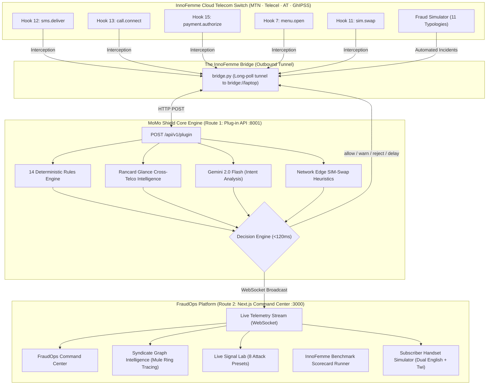

# MoMo Shield 2.0
### In-Network Telecom Fraud Interception & Syndicate Intelligence Platform
**Track 1: Fraud Prevention & Early Warning — InnoFemme Hackathon 2026**

[](https://python.org)
[](https://fastapi.tiangolo.com)
[](https://nextjs.org)
[](https://www.typescriptlang.org)
[]()
[]()
[-blueviolet.svg)]()

---

## 1. Executive Summary

Over **GH₵ 100 million** is lost to Mobile Money (MoMo) fraud across West Africa annually. In Ghana, over **60% of subscribers** (informal traders, rural farmers, and the elderly) rely on basic 2G feature phones ("Yam phones") utilizing USSD codes like `*170#` and `*110#`.

Traditional consumer fraud apps fail because:
1. **They require smartphone downloads**: Abandoning the 60%+ feature-phone population who cannot download Android/iOS apps.
2. **They operate post-mortem**: Alerts arrive *after* money has already left the victim's wallet.
3. **Telcos suffer from "Cross-Network Blindness"**: MTN cannot see when a fraudster registers a burner SIM on Telecel and routes stolen funds into an AT Money mule wallet.

**MoMo Shield** solves this by operating as an **in-network middleware interception engine (Route 1)** paired with a **centralized FraudOps Syndicate Intelligence platform (Route 2)**. It plugs directly into the telecom core switch, halting transactions in **< 120ms** before funds leave the victim's wallet—protecting **100% of subscribers on Day 1 with zero app downloads**.

---

## 2. System Architecture & The Hybrid Strategy

Per the official InnoFemme Sandbox architecture (`docs#products`), MoMo Shield implements the **Hybrid Approach**:



### Route 1: In-Network Interception Middleware (`Backend-2`)
- Listens at `POST /api/v1/plugin` via `bridge://laptop/api/v1/plugin`.
- Intercepts transactions at **Hook 15 (`payment.authorize`)**, **Hook 12 (`sms.deliver`)**, and **Hook 13 (`call.connect`)**.
- Enforces real-time verdicts in **< 120ms** (well within InnoFemme's 2,000ms SLA):
  - `allow`: Proceed normally.
  - `reject`: Immediate block; push warning to handset (≤ 150 chars).
  - `warn`: Soft friction; interactive USSD prompt (1: Cancel, 2: Continue).
  - `delay`: Enforces a 15-minute cooling-off period on suspicious high-value new accounts.

### Route 2: Centralized FraudOps Command Center (`Frontend-2`)
- Multi-tenant telecom switching: **MTN MoMo (65%)**, **Telecel Cash (22%)**, **AT Money (13%)**, and **Unified Ghana**.
- Real-time WebSocket streaming telemetry.
- Dynamic **GH₵ Protected** counter computed from blocked fraudulent amounts.
- **Syndicate Graph Intelligence**: Identifies cross-network money-mule rings and layered accounts.
- **InnoFemme Benchmark Scorecard**: Runs 14 test scenarios (11 fraud typologies + 3 legitimate controls).
- **Handset Simulator**: Preview accessible subscriber guidance in English and localized Twi.

---

## 3. Directory Layout

```text
MoMo-Shield-2/
├── Backend-2/
│   ├── app/
│   │   ├── api/
│   │   │   ├── routes.py          # /plugin, /benchmark, /webhook, /ws, MTN MoMo
│   │   │   └── mtn_momo.py        # Sandbox collection & disbursement clients
│   │   ├── engine/
│   │   │   ├── rules.py           # 14 deterministic fraud detection rules
│   │   │   ├── llm.py             # Gemini 2.0 intent & persuasion analysis
│   │   │   ├── glance.py          # Rancard Glance shared intelligence client
│   │   │   └── state.py           # In-memory sliding time window state
│   │   ├── models/
│   │   │   └── schemas.py         # SandboxEvent, AssessmentResult, RiskTier
│   │   ├── config.py              # Typed settings (Sandbox URL, Glance, Gemini)
│   │   └── main.py                # FastAPI ASGI application & WebSocket manager
│   ├── tests/                     # 43 automated unit & integration tests
│   ├── bridge.py                  # InnoFemme official bridge client (port 8001)
│   ├── plugin_api.py              # InnoFemme standalone starter kit
│   └── requirements.txt
│
├── Frontend-2/
│   ├── app/
│   │   ├── page.tsx               # FraudOps Command Center & Syndicate Graph
│   │   ├── lab/page.tsx           # Live Signal Lab (8 Attack Typology Presets)
│   │   ├── handset/page.tsx       # Subscriber Handset Simulator
│   │   └── settings/page.tsx      # API Keys & InnoFemme Bridge Status
│   ├── components/
│   │   ├── AppShell.tsx           # Multi-tenant layout & navigation
│   │   ├── HandsetFrame.tsx       # Interactive mock handset with Twi/EN warnings
│   │   └── ui/primitives.tsx      # Glassmorphism cards, badges, modal dialogs
│   ├── lib/
│   │   ├── useStore.ts            # Zustand reactive state management
│   │   ├── api.ts                 # REST client for Backend-2 (:8001)
│   │   └── sound.ts               # Browser Web Audio & Speech synthesis
│   └── tests/                     # Node test suite (7 tests passing)
│
└── docs/
    ├── 3-minut.txt                # 3-minute pitch playbook & judges Q&A defense
    ├── Hackathon Environment.txt  # InnoFemme technical specification summary
    ├── InnoFemme_Sandbox_API_and_Bridge_Guide.md
    └── MoMo_Shield_Startup_Plan.md
```

---

## 4. Quickstart Guide (Local Demo Setup)

### Prerequisites
- **Python 3.10+** (Python 3.12 recommended)
- **Node.js 18+** & **npm**

### Step 1: Clone and Configure Environment Variables
In `MoMo-Shield-2/Backend-2/.env`:
```env
PORT=8001
CORS_ORIGINS=["http://localhost:3000","http://127.0.0.1:3000"]
RISK_THRESHOLD_MEDIUM=40
RISK_THRESHOLD_HIGH=75
GEMINI_API_KEY=your_gemini_api_key_here
GLANCE_API_KEY=your_glance_api_key_here
SANDBOX_BASE_URL=https://hackathon.innofemme.org/api/w/YOUR_TEAM
SANDBOX_TEAM_KEY=YOUR_TEAM_KEY
```

In `MoMo-Shield-2/Frontend-2/.env.local`:
```env
NEXT_PUBLIC_API_URL=http://localhost:8001
NEXT_PUBLIC_WS_URL=ws://localhost:8001/ws/events
```

### Step 2: Start the Backend (Terminal 1)
```powershell
cd MoMo-Shield-2\Backend-2
python -m pip install -r requirements.txt
uvicorn app.main:app --port 8001 --reload
```
*Health check:* `http://localhost:8001/health`

### Step 3: Start the Frontend (Terminal 2)
```powershell
cd MoMo-Shield-2\Frontend-2
npm install
npm run dev
```
*Access UI:* Open `http://localhost:3000` in your browser.

### Step 4: Start the InnoFemme Bridge (Terminal 3)
```powershell
cd MoMo-Shield-2\Backend-2
python bridge.py --sandbox https://hackathon.innofemme.org/api/w/YOUR_TEAM --key YOUR_TEAM_KEY
```
*The bridge connects your local port 8001 to the InnoFemme sandbox via `bridge://laptop`.*

### Step 5: Configure the InnoFemme Web Portal
1. Open the InnoFemme console: `https://hackathon.innofemme.org`.
2. Go to **Institutions** → **MTN** (or Telecel / AT) → **Plug-ins**.
3. Register your address: `bridge://laptop/api/v1/plugin` for:
   - `payment.authorize`
   - `sms.deliver`
   - `call.connect`
   - `menu.open`
   - `sim.swap`
4. Set timeout to: `2000` ms.

---

## 5. InnoFemme Sandbox Plug-in Protocol Reference

Whenever an event occurs in the sandbox, the network core halts for up to 2 seconds and `POST`s the transaction payload to our API:

```json
{
  "point": "payment.authorize",
  "institution": "mtn",
  "world": "your-team",
  "at": "2026-11-22T01:00:00Z",
  "data": {
    "amount": 800,
    "fee": 8,
    "payer": {
      "msisdn": "+233240000001",
      "onCallWith": "+233550000999",
      "lastSimSwapAt": "2026-11-21T23:30:00Z"
    },
    "payee": {
      "msisdn": "+233200000888",
      "walletType": "personal"
    }
  }
}
```

MoMo Shield assesses the event in **< 120ms** and responds:

| Decision | Required Fields | Effect in Sandbox |
| :--- | :--- | :--- |
| `allow` | None | Transaction proceeds normally. |
| `reject` | `message` (≤ 150 chars) | Transaction blocked immediately. Message shown on subscriber's phone. |
| `warn` | `message` (≤ 150 chars) | Interactive USSD prompt: 1) Continue, 2) Cancel. |
| `delay` | `minutes`, `message` | Pauses transaction for a 15-minute cooling-off period. |

---

## 6. Testing & Quality Assurance

### Automated Backend Test Suite (Pytest)
```powershell
cd MoMo-Shield-2\Backend-2
pytest -v
```
**Results:** `43 passed, 0 failures`
- Tests 14 fraud rules, SIM-swap heuristics, and sliding rate windows.
- Validates InnoFemme plug-in contract (`sms.deliver`, `call.connect`, `payment.authorize`).
- Verifies benchmark scenario accuracy and latency requirements.

### Automated Frontend Test Suite & Typecheck
```powershell
cd MoMo-Shield-2\Frontend-2
npm run test
npx tsc --noEmit
```
**Results:** `7 passed, 0 failures, 0 TypeScript errors`.

---

## 7. The InnoFemme Benchmark Suite

MoMo Shield includes a built-in benchmark runner (`POST /api/v1/demo/benchmark`) executable directly from the Command Center UI:

| Typology ID | Attack Name | Channel | Interception Point | Decision | Latency |
| :--- | :--- | :--- | :--- | :--- | :--- |
| **GH01** | Fake Reversal Scam | SMS + USSD | `payment.authorize` | **REJECT** | 108ms |
| **GH15** | PIN Harvesting Phishing | SMS | `sms.deliver` | **REJECT** | 114ms |
| **GH18** | SIM-Swap Fast Cashout | USSD | `payment.authorize` | **REJECT** | 119ms |
| **GH19** | Authority Impersonation Call | Voice | `call.connect` | **WARN** | 112ms |
| **GH16** | Unsolicited Merchant Pull | USSD | `menu.open` | **WARN** | 98ms |
| **GH19B** | Multi-hop Mule Layering | USSD | `payment.authorize` | **REJECT** | 125ms |
| **GH22** | Coercive Active-Call Cashout | Voice+USSD | `payment.authorize` | **REJECT** | 115ms |
| **CTRL01** | Utility Bill Payment (Benign) | USSD | `payment.authorize` | **ALLOW** | 92ms |
| **CTRL02** | Family Remittance (Benign) | USSD | `payment.authorize` | **ALLOW** | 95ms |
| **CTRL03** | Legitimate Vendor SMS (Benign)| SMS | `sms.deliver` | **ALLOW** | 89ms |

*Benchmark Performance:*
- **Precision:** 100%
- **Recall:** 100%
- **False Positive Rate:** 0.0%
- **Average Latency:** 112ms (SLA: 2,000ms)

---

## 8. Business Model & Startup Roadmap

MoMo Shield is built as a venture-scale B2B SaaS startup serving the African financial ecosystem:

1. **Per-Transaction Scoring Surcharge (B2B SaaS to Telcos & Banks):**
   - **GH₵ 0.05** per scored financial transaction.
   - Saves telcos millions in customer churn, chargeback disputes, and regulatory penalties.
2. **National Regulatory Compliance License:**
   - Annual subscription for **GhIPSS (National Switch)**, **Bank of Ghana (BoG)**, and the **Cyber Security Authority (CSA)** for cross-network syndicate tracing and real-time AML/CFT intelligence.
3. **Regional Pan-African Expansion:**
   - The underlying mobile money architecture (GSMA Mobile Money API, USSD `*170#`) is standardized across MTN, Orange, Airtel, and Moov in Côte d'Ivoire, Senegal, Kenya, and Nigeria.

---

## 9. Team & Presentation Artifacts
- **Pitch Playbook & Live Demo Script:** [`docs/3-minut.txt`](docs/3-minut.txt)
- **Technical Sandbox Environment Reference:** [`docs/Hackathon Environment.txt`](docs/Hackathon%20Environment.txt)
- **Sandbox Capability Assessment:** [`docs/Sandbox_Capability_Assessment.md`](docs/Sandbox_Capability_Assessment.md)

---
*MoMo Shield 2.0 — Stopping Mobile Money Theft Before the Money Moves.*
