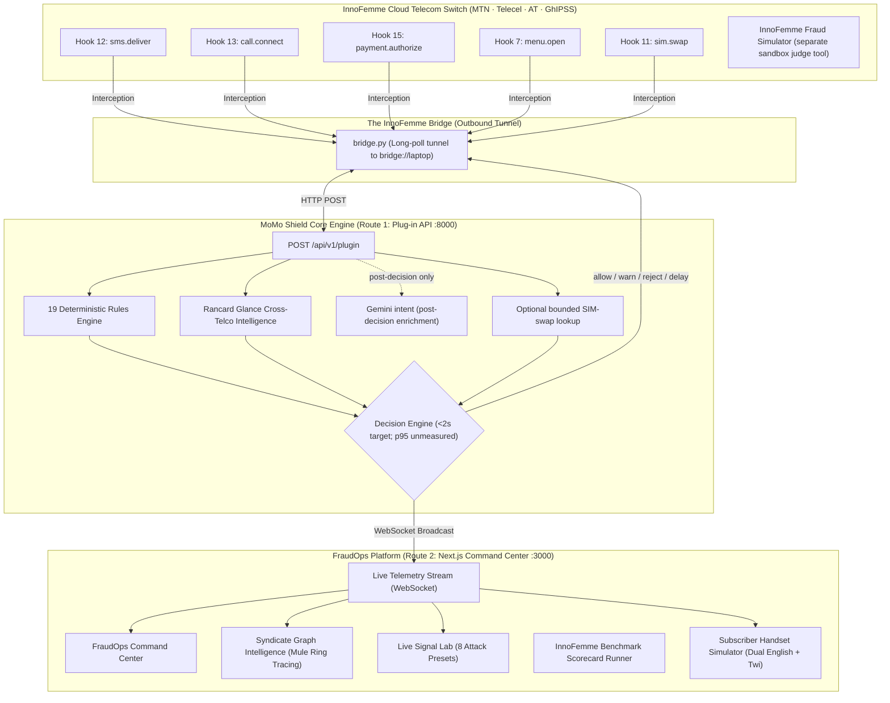

# MoMo Shield 2.0
### In-Network Telecom Fraud Interception & Syndicate Intelligence Platform
**Track 1: Fraud Prevention & Early Warning — InnoFemme Hackathon 2026**

[](https://python.org)
[](https://fastapi.tiangolo.com)
[](https://nextjs.org)
[](https://www.typescriptlang.org)
**Validation status:** test and end-to-end latency claims are intentionally not prefilled; see the current test run and sandbox rehearsal evidence.

---

## 1. Executive Summary

The Bank of Ghana estimates **GH₵ 101 million** in value at risk across banks, SDIs and payment providers in 2025, with mobile money a primary fraud vector (payment-provider-attributed losses ≈ GH₵ 37M). A large share of Ghanaian subscribers — informal traders, rural farmers, and the elderly (estimated majority on basic 2G feature phones, figure to be sourced) — rely on USSD codes like `*170#` and `*110#` rather than smartphones.

Traditional consumer fraud apps fail because:
1. **They require smartphone downloads**: Abandoning the feature-phone population who cannot download Android/iOS apps.
2. **They operate post-mortem**: Alerts arrive *after* money has already left the victim's wallet.
3. **Telcos suffer from "Cross-Network Blindness"** *(design motivation — to be validated with operators)*: MTN cannot see when a fraudster registers a burner SIM on Telecel and routes stolen funds into an AT Money mule wallet.

**MoMo Shield** is designed as an **in-network interception plug-in (Route 1)** paired with a **FraudOps dashboard (Route 2)**. The repository contains a direct plug-in handler covering all 16 documented InnoFemme interception points. Hook registration, credentials, end-to-end p95 latency, and judge-scorecard outcomes still require live sandbox verification; no measured performance or 100% coverage is claimed here.

---

## 2. System Architecture & The Hybrid Strategy

Per the official InnoFemme Sandbox architecture (`docs#products`), MoMo Shield implements the **Hybrid Approach**:



### Route 1: In-Network Interception Middleware (`Backend-2`)
- Listens at `POST /api/v1/plugin` via `bridge://laptop/api/v1/plugin`.
- Intercepts transactions at **Hook 15 (`payment.authorize`)**, **Hook 12 (`sms.deliver`)**, and **Hook 13 (`call.connect`)**.
- Applies deterministic and lexical rules synchronously; optional Glance/network lookups share a 1.0-second deadline. The bridge gives the API up to 1.7 seconds. These are configured budgets, not measured end-to-end p95 results:
  - `allow`: Proceed normally.
  - `reject`: Immediate block; push warning to handset (≤ 150 chars).
  - `warn`: Soft friction; interactive USSD prompt (1: Cancel, 2: Continue).
  - `delay`: A high-risk payment receives one 10-minute cooling period; a retry marked `afterDelay` is rejected if it remains high-risk.

### Route 2: Centralized FraudOps Command Center (`Frontend-2`)
- Multi-tenant telecom switching: **MTN MoMo**, **Telecel Cash**, **AT Money**, and **Unified Ghana** (market-share split is illustrative pending verified figures).
- Real-time WebSocket streaming telemetry.
- Dynamic **GH₵ Protected** counter computed from blocked fraudulent amounts.
- **Fund-Flow / Syndicate Graph**: Rule-based visualization of *observed* plug-in relationships — directed SMS/call/payment edges with inferred roles (suspect/mule/collector). Not a trained graph model; scope is this deployment's telemetry.
- **Recovery Mode — Evidence Packs**: `GET /api/v1/evidence-pack/{msisdn}` assembles incident summary, directed fund trail, linked assessments, and identity provenance (verified vs event-supplied claims labeled) for post-incident reporting.
- **Local Threat Ledger ("Mini-Glance")**: Proprietary sqlite ledger of scam-confirmed numbers — sub-ms repeat-offender boost, 30-day expiry, 14-day dormancy decay, exoneration endpoint.
- **OTP Read-Out Defense**: Genuine operator OTPs are never flagged; risky-call markers trigger bilingual Twi/English advisories, and OTP→transaction velocity (+30 corroborating) escalates read-out fraud toward delay.
- **Signal Velocity**: Live 15-minute event-rate telemetry with burst detection and top talkers.
- **Local regression fixture scorecard**: Exercises fixed rule scenarios. It does not invoke the InnoFemme Fraud Simulator and is not a judge scorecard.
- **Handset Simulator**: Preview accessible subscriber guidance in English and localized Twi.

---

## 3. Directory Layout

```text
MoMo-Shield-2/
├── Backend-2/
│   ├── app/
│   │   ├── api/
│   │   │   └── routes.py          # /plugin, /fund-flow, /evidence-pack,
│   │   │                         # /velocity, /threat-ledger, /benchmark,
│   │   │                         # /webhook, /ws, MTN MoMo
│   │   ├── engine/
│   │   │   ├── rules.py           # 19 deterministic fraud detection rules
│   │   │   ├── state.py           # Event windows + SMS blast detector
│   │   │   └── kb.py              # Fraud Case Corpus (lexical + semantic RAG)
│   │   ├── integrations/
│   │   │   ├── gemini.py          # Gemini 2.0 intent (post-decision only)
│   │   │   ├── glance.py          # Rancard Glance shared intelligence client
│   │   │   ├── nia.py             # NIA Ghana Card verify (live + heuristics)
│   │   │   ├── infofemme.py       # Network API: SIM-swap, subscriber, SMS
│   │   │   ├── local_threat_db.py # Proprietary threat ledger (sqlite)
│   │   │   ├── fund_flow.py       # Observed fund-flow edge ledger
│   │   │   ├── mtn_momo.py        # Sandbox collection & disbursement clients
│   │   │   └── sandbox.py         # Sandbox intervention bridge
│   │   ├── models/
│   │   │   └── schemas.py         # SandboxEvent, AssessmentResult, RiskTier
│   │   ├── config.py              # Typed settings (Sandbox URL, Glance, Gemini)
│   │   └── main.py                # FastAPI ASGI application & WebSocket manager
│   ├── tests/                     # Backend unit & integration tests
│   ├── bridge.py                  # InnoFemme bridge client (backend default port 8000)
│   ├── plugin_api.py              # InnoFemme standalone starter kit
│   └── requirements.txt
│
├── Frontend-2/
│   ├── app/
│   │   ├── page.tsx               # FraudOps Command Center & Syndicate Graph
│   │   ├── lab/page.tsx           # Live Signal Lab (8 Attack Typology Presets)
│   │   ├── handset/page.tsx       # Subscriber Handset Simulator
│   │   └── settings/page.tsx      # API Keys & InnoFemme Bridge Status
│   ├── components/
│   │   ├── AppShell.tsx           # Multi-tenant layout & navigation
│   │   ├── FraudGraph.tsx         # Live fund-flow graph + evidence packs
│   │   ├── VelocityCard.tsx       # Signal velocity telemetry + burst badge
│   │   ├── ThreatLedgerCard.tsx   # Local threat ledger + exoneration
│   │   ├── HandsetFrame.tsx       # Interactive mock handset with Twi/EN warnings
│   │   └── ui/primitives.tsx      # Glassmorphism cards, badges, modal dialogs
│   ├── lib/
│   │   ├── useStore.ts            # Zustand reactive state management
│   │   ├── api.ts                 # REST client for Backend-2 (default :8000)
│   │   └── sound.ts               # Browser Web Audio & Speech synthesis
│   └── tests/                     # Node test suite (7 tests passing)
│
└── docs/
    ├── 3-minut.txt                # Evidence-based pitch & live-demo verification playbook
    ├── Hackathon Environment.txt  # InnoFemme technical specification summary
    ├── InnoFemme_Sandbox_API_and_Bridge_Guide.md
    └── MoMo_Shield_Startup_Plan.md # Archived aspirational plan; not current implementation status
```

---

## 4. Quickstart Guide (Local Demo Setup)

### Prerequisites
- **Python 3.10+** (Python 3.12 recommended)
- **Node.js 18+** & **npm**

### Step 1: Clone and Configure Environment Variables
In `MoMo-Shield-2/Backend-2/.env`:
```env
PORT=8000
CORS_ORIGINS=http://localhost:3000,http://127.0.0.1:3000
RISK_THRESHOLD_MEDIUM=40
RISK_THRESHOLD_HIGH=75
GEMINI_API_KEY=your_gemini_api_key_here
GLANCE_API_KEY=your_glance_api_key_here
SANDBOX_BASE_URL=https://hackathon.innofemme.org/api/w/YOUR_TEAM
SANDBOX_TEAM_KEY=YOUR_TEAM_KEY
```

In `MoMo-Shield-2/Frontend-2/.env.local`:
```env
NEXT_PUBLIC_API_URL=http://localhost:8000
NEXT_PUBLIC_WS_URL=ws://localhost:8000/api/v1/ws/telemetry
```

### Step 2: Start the Backend (Terminal 1)
```powershell
cd MoMo-Shield-2\Backend-2
python -m pip install -r requirements.txt
uvicorn main:app --host 0.0.0.0 --port 8000 --reload
```
*Health check:* `http://localhost:8000/health`

### Step 3: Start the Frontend (Terminal 2)
```powershell
cd MoMo-Shield-2\Frontend-2
npm install
npm run dev
```
*Access UI:* Open `http://localhost:3000` in your browser.

### Step 4: Start the InnoFemme Bridge (Terminal 3)
```powershell
cd MoMo-Shield-2\Backend-2
python bridge.py --sandbox https://hackathon.innofemme.org/api/w/YOUR_TEAM --key YOUR_TEAM_KEY
```
*The bridge defaults to forwarding local port 8000 to the InnoFemme sandbox via `bridge://laptop` and uses a 1.7-second API-response timeout.*

### Step 5: Configure the InnoFemme Web Portal
1. Open the InnoFemme console: `https://hackathon.innofemme.org`.
2. Go to **Institutions** → **MTN** (or Telecel / AT) → **Plug-ins**.
3. Register your address: `bridge://laptop/api/v1/plugin` for:
   - `payment.authorize`
   - `sms.deliver`
   - `call.connect`
   - `menu.open`
   - `sim.swap`
4. Set timeout to at most `2000` ms. The bridge uses a 1.7-second local API timeout; rehearse end to end.

---

## 5. InnoFemme Sandbox Plug-in Protocol Reference

Whenever an event occurs in the sandbox, the network core halts for up to 2 seconds and `POST`s the transaction payload to our API:

```json
{
  "point": "payment.authorize",
  "institution": "mtn",
  "world": "your-team",
  "at": "2026-11-22T01:00:00Z",
  "data": {
    "amount": 800,
    "fee": 8,
    "payer": {
      "msisdn": "+233240000001",
      "onCallWith": "+233550000999",
      "lastSimSwapAt": "2026-11-21T23:30:00Z"
    },
    "payee": {
      "msisdn": "+233200000888",
      "walletType": "personal"
    }
  }
}
```

MoMo Shield applies a bounded decision path (configured external-lookup budget: 1.0 second) and responds. End-to-end latency remains unmeasured until a bridge rehearsal:

| Decision | Required Fields | Effect in Sandbox |
| :--- | :--- | :--- |
| `allow` | None | Transaction proceeds normally. |
| `reject` | `message` (≤ 150 chars) | Transaction blocked immediately. Message shown on subscriber's phone. |
| `warn` | `message` (≤ 150 chars) | Interactive USSD prompt: 1) Continue, 2) Cancel. |
| `delay` | `minutes`, `message` | Pauses a high-risk payment for one 10-minute cooling period. |

---

## 6. Testing & Quality Assurance

### Automated Backend Test Suite (Pytest)
```powershell
cd MoMo-Shield-2\Backend-2
pytest -v
```
Test results should be taken from the actual command output. Tests cover the plug-in contract, documented call criteria, missing identities, concurrent state access, reset, and explicit local-fixture benchmark scope.

### Automated Frontend Test Suite & Typecheck
```powershell
cd MoMo-Shield-2\Frontend-2
npm run test
npx tsc --noEmit
```
Record actual test and typecheck command output; do not treat old counts as current validation.

---

## 7. Local Regression Fixtures (Not the InnoFemme Benchmark)

`POST /api/v1/demo/benchmark` runs fixed, local deterministic-rule fixtures for dashboard regression checks. Its timing is only the time spent evaluating those in-process fixtures; it excludes request routing, the bridge, network lookups, and the sandbox. Fixture-derived precision/recall and estimated protected amounts are not observed judge metrics. For judging, run the InnoFemme Fraud Simulator and inspect its Fraud Console scorecard, while capturing bridge and API timings separately.

---

## 8. Business Model & Startup Roadmap

MoMo Shield is built as a venture-scale B2B SaaS startup serving the African financial ecosystem:

1. **Per-Transaction Scoring Surcharge (B2B SaaS to Telcos & Banks):**
   - **GH₵ 0.05** per scored financial transaction *(proposed pricing — assumption pending pricing research)*.
   - Saves telcos millions in customer churn, chargeback disputes, and regulatory penalties.
2. **National Regulatory Compliance License:**
   - Annual subscription for **GhIPSS (National Switch)**, **Bank of Ghana (BoG)**, and the **Cyber Security Authority (CSA)** for cross-network syndicate tracing and real-time AML/CFT intelligence.
3. **Regional Pan-African Expansion:**
   - The underlying mobile money architecture (GSMA Mobile Money API, USSD `*170#`) is standardized across MTN, Orange, Airtel, and Moov in Côte d'Ivoire, Senegal, Kenya, and Nigeria.

---

## 9. Team & Presentation Artifacts
- **Pitch Playbook & Live Demo Script:** [`docs/3-minut.txt`](docs/3-minut.txt)
- **Technical Sandbox Environment Reference:** [`docs/Hackathon Environment.txt`](docs/Hackathon%20Environment.txt)
- **Sandbox Capability Assessment:** [`docs/Sandbox_Capability_Assessment.md`](docs/Sandbox_Capability_Assessment.md)

---
*MoMo Shield 2.0 — Stopping Mobile Money Theft Before the Money Moves.*
