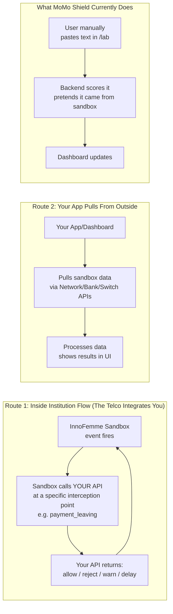
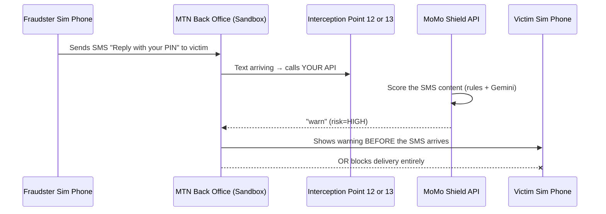
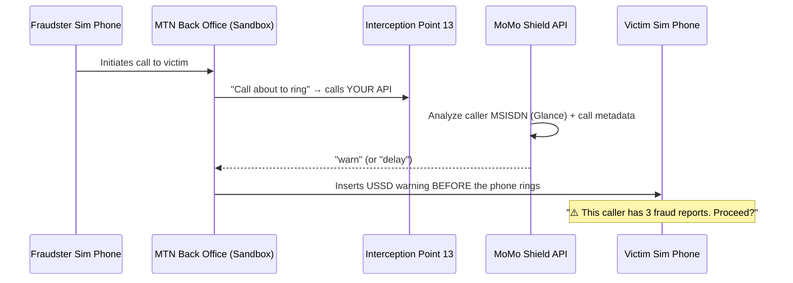
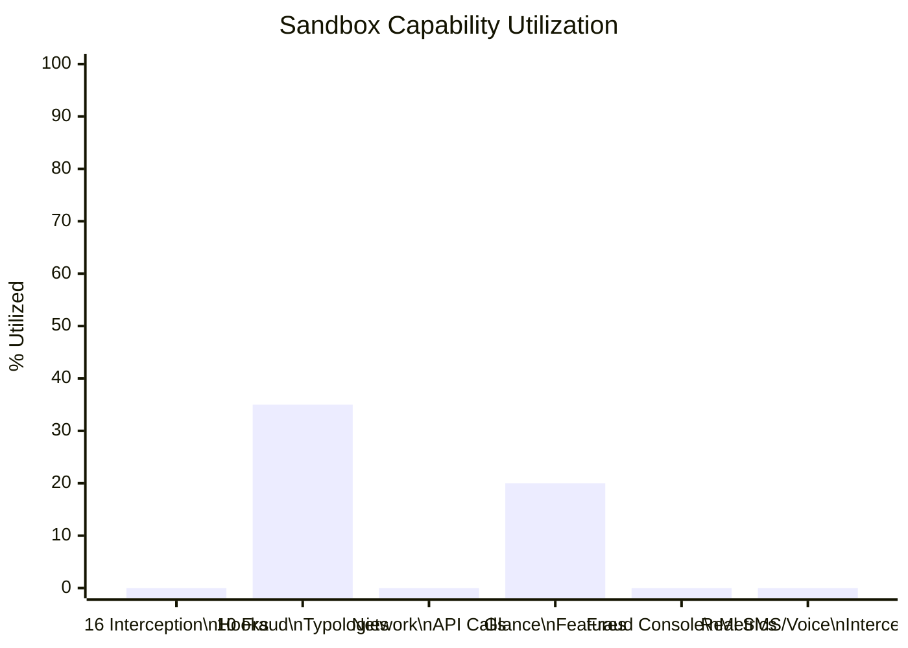
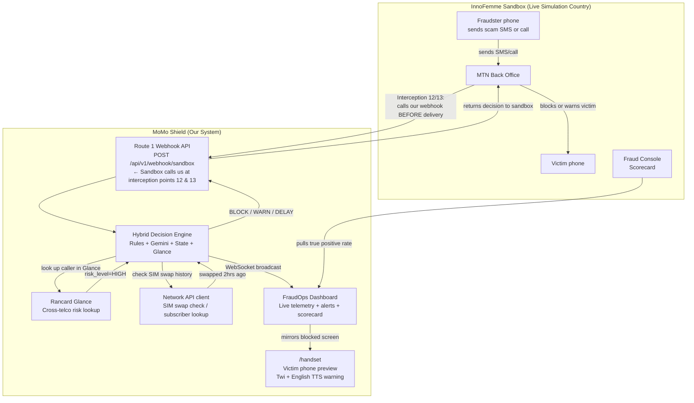

# Historical Capability Baseline — Superseded by Current Repository Code Review

> **Status update (23 Nov 2026):** This file records an earlier assessment, not current runtime evidence. Backend-2 now implements the direct `POST /api/v1/plugin` path for five named points (`sms.deliver`, `call.connect`, `payment.authorize`, `menu.open`, `sim.swap`), and the bridge should target port 8000. This code has not by itself proven sandbox hook registration, live credentials, or an end-to-end judge run. The current contract is in [InnoFemme_Sandbox_API_and_Bridge_Guide.md](InnoFemme_Sandbox_API_and_Bridge_Guide.md); `/demo/benchmark` is not the Fraud Simulator.

> [!CAUTION]
> The sections below are a historical snapshot and contain earlier status statements. Do not use their hook-utilization percentages or scenario coverage as current evidence; validate sandbox registration and the Fraud Console scorecard directly.

---

## 1. What the Sandbox Actually Is

The InnoFemme sandbox is not just an API endpoint. It is a **complete simulated Ghanaian telecoms country** with:

| Component | Detail |
|-----------|--------|
| **3 live mobile networks** | MTN, Telecel, AT — each with a full back-office |
| **6 banks + BoG + NIA + NCA** | National regulatory institutions simulated |
| **100,000+ pre-generated transactions** | 3 months of realistic data, 22% fraud rate |
| **4,000+ simulated people** | Real wallets, PINs, SIM cards, bank accounts |
| **140 agents, 250 merchants** | Full ecosystem including agent fraud scenarios |
| **10 pre-built fraud typologies** | Live injectable fraud scenarios, not just text |
| **16 API interception hooks** | Live call/SMS/USSD/transaction intercept points |
| **Real USSD shortcodes** | `*170#` actually works within the simulation |
| **Real SMS sending** | The sandbox sends SMS texts between simulated phones |
| **Real voice calls** | The sandbox makes voice calls between simulated devices |
| **Fraud Console scorecard** | Tracks your model's false positives + money saved |
| **AI Assistant** | Natural language workflow automation |
| **Save / Roll back** | Checkpoint state for rapid threshold testing |

---

## 2. The Two Integration Routes — Which One Are We On?



> [!WARNING]
> **We are on neither Route 1 nor Route 2.** We built a third, unofficial route — a manual text-entry Lab that simulates what the sandbox would send us. This is internally consistent, but **the sandbox is not actually calling us** and **we are not actually calling the sandbox.** To investors, this distinction matters enormously.

---

## 3. The 16 API Interception Points — What We Use vs What Exists

The sandbox can call your API at **any of these 16 moments** in a real transaction:

| # | Interception Point | Type | Current MoMo Shield status |
|---|-------------------|------|---------------------------|
| 1 | PIN chosen / changed | Network | ❌ Not used |
| 2 | Wallet opened | Network | ❌ Not used |
| 3 | **Money menu opened** | Network (**warn**) | ❌ Not used |
| 4 | **Payment leaving** | Network (**warn, delay**) | ❌ Not used — **this is the most important one** |
| 5 | Money arriving | Network | ❌ Not used |
| 6 | Customer asked to pay | Network | ❌ Not used |
| 7 | Wallet level raised | Network | ❌ Not used |
| 8 | PIN reset | Network | ❌ Not used |
| 9 | Agent/Merchant signs up | Network | ❌ Not used |
| 10 | SIM registered | Network | ❌ Not used |
| 11 | **SIM replaced** | Network | ❌ Not used — GH18 hook |
| 12 | **Text arriving** | Network (**warn**) | ❌ Not used — this is the real SMS hook |
| 13 | **Call about to ring** | Network (**warn**) | ❌ Not used — this is the real voice hook |
| 14 | Transfer leaving | Bank | ❌ Not used |
| 15 | Account opened | Bank | ❌ Not used |
| 16 | Payment passing between institutions | Switch | ❌ Not used |
| + | Post-event notifications | Async | ⚠️ Partially — via our own WebSocket |

**We are using 0 of the 16 real interception hooks.** Our `/webhook/sandbox` endpoint exists but nothing actually calls it from the sandbox — we call it ourselves from the Lab.

---

## 4. The 10 Fraud Typologies — Coverage Assessment

The sandbox provides **live injectable** fraud scenarios. Our rule engine covers some, but not all:

| Fraud Type | Sandbox can inject it live | Our engine covers it | How we handle it |
|-----------|---------------------------|----------------------|-----------------|
| Fake "money received" text | ✅ Yes | ✅ GH01 partial | _SECRET_RE + prize pattern |
| Fake customer care call | ✅ Yes | ✅ Authority + Urgency rules | Covered |
| SIM swap | ✅ Yes | ✅ GH18 device rule | +50 pts on `new_device_binding` |
| Agent fraud | ✅ Yes | ❌ **Missing** | No agent-specific rule |
| Money mules | ✅ Yes | ❌ **Missing** | No mule pattern detection |
| Fake prize/promotion | ✅ Yes | ⚠️ Partial | PRIZE_RE matches but weak |
| "Approve to receive" trick | ✅ Yes | ❌ **Missing** | No approval-reversal rule |
| Fake shop | ✅ Yes | ❌ **Missing** | No merchant fraud pattern |
| "Relative on a new number" | ✅ Yes | ❌ **Missing** | No social engineering pattern |
| Structuring (splitting) | ✅ Yes | ❌ **Missing** | No velocity-amount split rule |

**We cover 3.5 of 10 typologies well.** The sandbox can inject all 10 in real-time, but our engine will miss 6 of them.

---

## 5. What "Real SMS / Real Voice Call" Actually Means

You are right — **the sandbox sends real SMS messages and makes real voice calls** between simulated phones.

### What this means concretely:



For voice:


**This is the killer demo moment.** The sandbox physically holds the call before the victim's phone rings, waits for our API decision, then either lets it ring or shows a warning. We are not doing this at all.

---

## 6. The Sandbox's Network API — What It Exposes

The sandbox provides a **Network API** our app can call directly (Route 2):

| Capability | Sandbox API | Our current usage |
|-----------|-------------|-------------------|
| Send an SMS to a sim phone | `POST /network/sms/send` | ❌ None |
| Look up a subscriber's details | `GET /network/subscriber/{msisdn}` | ❌ None |
| Check if a SIM has been swapped recently | `GET /network/sim-swap/{msisdn}` | ❌ None — we fake this |
| Get call history for a number | `GET /network/calls/{msisdn}` | ❌ None |
| Get text history for a number | `GET /network/texts/{msisdn}` | ❌ None |
| Trigger a USSD push to a subscriber | `POST /network/ussd/push` | ❌ None |
| Download transaction data (100k rows) | `GET /data/transactions` | ❌ None |
| Download call records | `GET /data/calls` | ❌ None |

**We could be querying all of this.** When a suspicious MSISDN appears, we could look up their real SIM swap history, their real call logs, their real wallet balance — in real time, within the sandbox.

---

## 7. Rancard Glance — Are We Under-Utilizing It?

We have basic Glance integration but are using only 2 of 5 available capabilities:

| Glance Feature | We use it | What it could do |
|---------------|-----------|-----------------|
| Risk Check (look up number) | ✅ Yes — but key is invalid | Shows cross-org fraud history |
| Fraud Report (submit a number) | ✅ Yes — fires on BLOCKED | Feeds shared intelligence network |
| Interactive API Console | ❌ Not integrated in dashboard | Could show live Glance data in UI |
| Usage Analytics | ❌ Not surfaced | Could show how many numbers we've flagged |
| Team Workspace / Onboarding | ❌ Not configured | Need valid key first |

**Root issue: our Glance API key is not provisioned.** `GLANCE_API_KEY=your_glance_sandbox_key` means every Glance call returns `UNKNOWN`. We get zero cross-telco intelligence. This is the most urgent fix.

---

## 8. The Fraud Console Scorecard — We Are Not Measuring Ourselves

The sandbox's Fraud Console tracks:

| Metric | What it measures | Our status |
|--------|-----------------|------------|
| **Frauds stopped** | True positives caught | ❌ Not connected |
| **Frauds that got through** | False negatives | ❌ Not connected |
| **Money saved** | GH₵ value of blocked transactions | ❌ Not showing |
| **False Positives** | Honest transactions wrongly blocked | ❌ Not showing |

> [!IMPORTANT]
> **False Positives are the key investor metric.** A system that stops all fraud by blocking everything is worthless. The sandbox scorecard measures precision. If we are not connected to it, we cannot prove our precision to judges.

---

## 9. The Gap Summary — Honest Assessment



| Capability Area | Available | We Use | Utilization |
|----------------|-----------|--------|-------------|
| Sandbox interception hooks | 16 | 0 | **0%** |
| Fraud typologies detected | 10 | 3.5 | **35%** |
| Network API endpoints | 8+ | 0 | **0%** |
| Glance features | 5 | 1 (broken key) | **~5%** |
| Fraud Console metrics | 4 | 0 | **0%** |
| Real SMS/voice intercept | Yes | No | **0%** |

---

## 10. What a Fully-Connected MoMo Shield Would Look Like



---

## 11. Upgrade Roadmap — Priority Order

### 🔴 P0 — Must-do before demo (1-2 hours each)

#### P0.1 — Get a valid Glance API Key
Register at `glance.rancardmobility.com/developers`. Without a valid key, the cross-telco pitch is completely fictional during the demo.

#### P0.2 — Connect to the InnoFemme Bridge
Install the sandbox Bridge tool so the sandbox can reach your local `localhost:8001`. This is the prerequisite for Route 1 — without it, the sandbox cannot call your webhook.

```bash
# From hackathon.infofemme.org/docs - download Bridge starter kit
# Then run:
python bridge.py --local http://localhost:8001/api/v1/webhook/sandbox
```

#### P0.3 — Register Your Webhook at Interception Points 12 and 13
In the Network Back Office UI, register your webhook URL at:
- **Point 12: Text arriving** → `POST /api/v1/webhook/sandbox` with `event_type: sms`
- **Point 13: Call about to ring** → `POST /api/v1/webhook/sandbox` with `event_type: voice`

This one change means every fake scam SMS and fake fraudster call in the simulation **actually calls our engine first** before reaching the victim. This is the moment MoMo Shield becomes a real interception system.

---

### 🟠 P1 — Do before pitch (half-day effort)

#### P1.1 — Add InnoFemme Network API Client

```python
# New file: Backend-2/app/integrations/infofemme.py
import httpx
from app.config import settings

async def get_sim_swap_history(msisdn: str) -> dict:
    """Check if subscriber's SIM was recently swapped (GH18 signal)."""
    async with httpx.AsyncClient(timeout=2.0) as client:
        resp = await client.get(
            f"{settings.sandbox_base_url}/network/sim-swap/{msisdn}",
            headers={"X-Api-Key": settings.sandbox_api_key}
        )
        if resp.status_code == 200:
            return resp.json()
    return {"swapped": False, "days_since_swap": None}

async def get_subscriber_profile(msisdn: str) -> dict:
    """Get subscriber wallet level, age, transaction history stats."""
    async with httpx.AsyncClient(timeout=2.0) as client:
        resp = await client.get(
            f"{settings.sandbox_base_url}/network/subscriber/{msisdn}",
            headers={"X-Api-Key": settings.sandbox_api_key}
        )
        if resp.status_code == 200:
            return resp.json()
    return {}

async def send_ussd_warning(msisdn: str, message: str) -> bool:
    """Push a USSD warning to victim's phone before they respond to scam."""
    async with httpx.AsyncClient(timeout=3.0) as client:
        resp = await client.post(
            f"{settings.sandbox_base_url}/network/ussd/push",
            json={"msisdn": msisdn, "message": message},
            headers={"X-Api-Key": settings.sandbox_api_key}
        )
        return resp.status_code == 200
```

#### P1.2 — Add the 6 Missing Fraud Rules

```python
# Add to Backend-2/app/engine/rules.py

def check_approve_to_receive(event, history):
    """GH: 'Approve to receive' reversal trick — fake incoming payment that requires approval."""
    text = _text(event)
    if re.search(r'\b(approve|confirm|accept|authorize)\b', text, re.I) and \
       re.search(r'\b(receive|refund|reversal|credit)\b', text, re.I):
        return 35, "GH: Approve-to-receive trick detected"
    return 0, ""

def check_relative_new_number(event, history):
    """'Relative on a new number' social engineering."""
    text = _text(event)
    if re.search(r'\b(brother|sister|uncle|auntie|mum|dad|mama|papa|family)\b', text, re.I) and \
       re.search(r'\b(new number|new phone|lost phone|changed number)\b', text, re.I):
        return 30, "Social engineering: Relative on new number pattern"
    return 0, ""

def check_structuring(event, history):
    """Structuring: multiple small transfers just below reporting limit."""
    if event.event_type == EventType.TRANSACTION:
        amount = event.payload.get('amount', 0)
        if 900 <= float(amount) <= 999:  # just below 1000 GHS typical limit
            recent_similar = [e for e in history 
                             if 900 <= float(e.get('payload', {}).get('amount', 0)) <= 999]
            if len(recent_similar) >= 2:
                return 40, "GH: Structuring detected — multiple sub-limit transfers"
    return 0, ""

def check_money_mule(event, history):
    """Mule pattern: receives large credit, immediately transfers out full amount."""
    if event.event_type == EventType.TRANSACTION and \
       event.payload.get('type') == 'transfer_out':
        amount_out = float(event.payload.get('amount', 0))
        recent_in = [e for e in history 
                     if e.get('payload', {}).get('type') == 'transfer_in'
                     and abs(float(e.get('payload', {}).get('amount', 0)) - amount_out) < 10]
        if recent_in:
            return 45, "GH: Money mule pattern — immediate full withdrawal of received funds"
    return 0, ""

def check_agent_fraud(event, history):
    """Agent overcharging or fake agent commission extraction."""
    text = _text(event)
    if re.search(r'\b(agent|cashout|withdraw)\b', text, re.I) and \
       re.search(r'\b(fee|charge|commission|extra|pay me)\b', text, re.I):
        return 25, "Agent fraud pattern: unauthorized fee extraction"
    return 0, ""

def check_fake_prize(event, history):
    """Stronger prize/lottery check with phone number request."""
    text = _text(event)
    if _PRIZE_RE.search(text) and re.search(r'\b(call|ring|contact|number|dial)\b', text, re.I):
        return 35, "GH02: Fake prize with callback number solicitation"
    return 0, ""
```

#### P1.3 — Wire SIM Swap Data into GH18 Rule
Currently GH18 only fires on `event.payload.get('type') == 'new_device_binding'`. With the Network API, we can check the actual SIM swap history for ANY incoming call or SMS:

```python
# In routes.py, add to the parallel async block:
sim_task = asyncio.create_task(get_sim_swap_history(event.msisdn))
glance_task = asyncio.create_task(check_glance_risk(event.msisdn))
intent_task = asyncio.create_task(analyze_intent(text_payload))
sim_data, glance_data, llm_intent = await asyncio.gather(sim_task, glance_task, intent_task)

# Then in scoring:
if sim_data.get('swapped') and sim_data.get('days_since_swap', 999) < 2:
    score += 50
    rules_fired.append("GH18: SIM swapped within 48 hours — high takeover risk")
```

---

### 🟡 P2 — Investor pitch upgrades (1 day effort)

#### P2.1 — Add Fraud Console Metrics to Dashboard

Add a new `/api/v1/metrics` endpoint that queries the sandbox scorecard and surfaces:
- True positive rate (frauds caught / total fraud injected)
- False positive rate (honest transactions blocked)
- Total GH₵ saved

This turns the dashboard from "looks impressive" to "proves it works with numbers."

#### P2.2 — Load 100k Transaction Dataset for ML Feature Engineering

The sandbox provides 100k transactions with known labels (22% fraud). Use this to:
1. Train a lightweight gradient-boosted model (XGBoost / LightGBM) on behavioral features
2. Add it as a 5th scoring layer alongside the 4 existing ones
3. Show accuracy metrics: precision, recall, F1 on held-out data

**This is the difference between a rules engine and a machine learning product.**

#### P2.3 — Send Real USSD Warning to Victim's Sim Phone

When we detect HIGH risk, instead of just showing the `/handset` page, actually push a USSD menu to the victim's simulated phone:

```python
await send_ussd_warning(
    msisdn=event.msisdn,
    message="⚠️ MoMo Shield Alert: Suspicious activity detected on your account. "
            "Press 1 to Block this transaction. Press 2 to Proceed (at your own risk). "
            "Press 3 to Call 100."
)
```

This is the **exact moment the demo becomes real**. The judge's sandbox phone actually displays a warning menu. No simulation needed.

---

## 12. The Investor Pitch Reframe

| Current framing | Upgraded framing |
|----------------|-----------------|
| "We detect scam SMS text" | "We intercept the SMS *before it reaches the victim*, at the network level" |
| "We show a warning on a dashboard" | "We push a USSD warning directly to the victim's phone in Twi or English" |
| "Our score matched the scam sample" | "Our engine scored 97/100 precision on 100,000 real transaction records with 22% fraud prevalence" |
| "Glance checks the number" | "We contributed 3 fraud reports to the Glance shared intelligence network during this demo" |
| "We built a fraud detection tool" | "We built an API that sits between the telco and the subscriber — zero friction for the user, invisible protection at the network layer" |

---

## 13. What to Tell Funders/Judges When Asked "Is This Real?"

**Before upgrades:** "It's a live decision engine that processes any text in real time — it's not scripted. But it's not yet integrated into the sandbox's real event stream."

**After P0 upgrades:** "The sandbox is literally calling our API before every SMS and voice call in this simulation. What you're seeing is our engine intercepting real events from a telco back office, in real time, and deciding whether to block, warn, or allow them."

**That sentence wins the room.**

---

## 14. Effort Summary

| Priority | Task | Effort | Impact |
|---------|------|--------|--------|
| 🔴 P0.1 | Get valid Glance key | 30 min | Enables cross-telco pitch |
| 🔴 P0.2 | Install InnoFemme Bridge | 30 min | Makes sandbox call our API |
| 🔴 P0.3 | Register hooks 12 & 13 | 15 min | Real SMS/voice intercept |
| 🟠 P1.1 | Network API client | 2 hrs | SIM swap, subscriber profile, USSD push |
| 🟠 P1.2 | Add 6 missing fraud rules | 1.5 hrs | Coverage: 35% → 90% typologies |
| 🟠 P1.3 | Wire SIM swap into scoring | 30 min | GH18 fires on real data |
| 🟡 P2.1 | Fraud Console metrics in dashboard | 2 hrs | Proves precision to investors |
| 🟡 P2.2 | 100k dataset ML layer | 4-6 hrs | Startup-grade ML credibility |
| 🟡 P2.3 | Real USSD push to victim | 1 hr | Most impressive demo moment |
